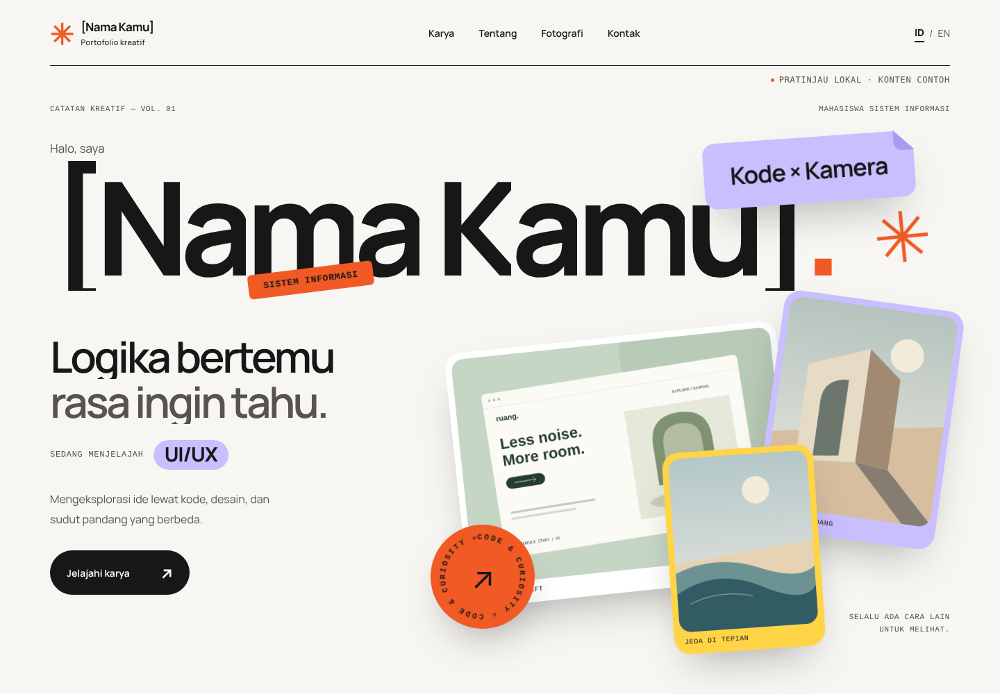

# Daffa — portofolio & Arsip Cahaya

Satu website Next.js dengan dua halaman utama yang sengaja berbeda dunia:

| Alamat | Isi | Panduan |
| --- | --- | --- |
| `/id/` dan `/en/` | Portofolio kreatif: proyek, tentang, kontak (ID/EN, GSAP) | [apps/portfolio/README.md](apps/portfolio/README.md) |
| `/foto/` | Arsip Cahaya: orbit foto 3D, lembar kontak, jendela bidik (Indonesia, GSAP) | bagian "Arsip Cahaya" di panduan yang sama |



Menu "Fotografi" di portofolio membuka `/foto/`, dan tautan "Portofolio" di Arsip Cahaya kembali ke `/id/`. Keduanya satu deployment, satu domain.

## Menjalankan

Gunakan Node.js 22 LTS. Dari folder ini:

```sh
npm ci            # memasang dependensi (npm workspaces)
npm run dev       # http://127.0.0.1:3000/id/ dan http://127.0.0.1:3000/foto/
```

Pemeriksaan:

```sh
npm run typecheck
npm run lint
npm run build
```

## Deployment

Di Vercel, buat satu project dari repositori ini dengan **Root Directory** `apps/portfolio`. Vercel memasang dependensi dari `package-lock.json` di folder utama secara otomatis. Detail build (termasuk `build:release`) ada di panduan portofolio.

## Dokumen lain

- [PRD](PRD-Portofolio-Kreatif.md)
- [Master prompt](MASTER-PROMPT.md)
- [Hasil pengujian portofolio](apps/portfolio/QA-REPORT.md)
