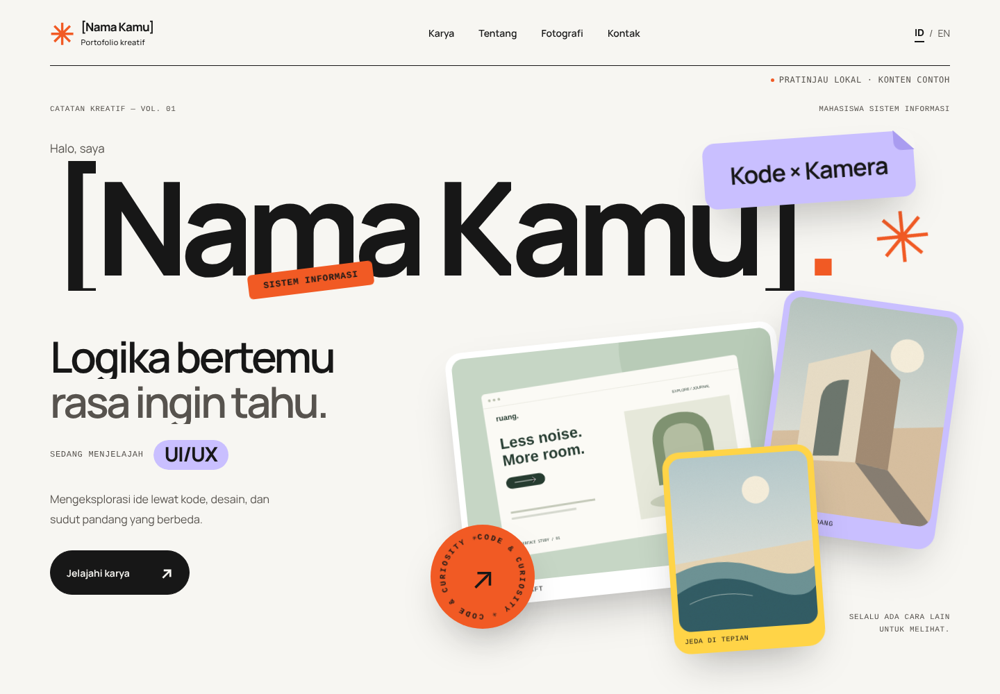

# Daffa — portofolio & arsip foto

Monorepo dengan dua website Next.js yang dideploy terpisah dari repositori yang sama.

| Website | Folder | Dev lokal | Panduan |
| --- | --- | --- | --- |
| Portofolio kreatif (ID/EN, GSAP) | `apps/portfolio` | `npm run dev` → http://127.0.0.1:3000/id/ | [apps/portfolio/README.md](apps/portfolio/README.md) |
| Arsip Cahaya, website fotografi | `apps/photography` | `npm run dev:photo` → http://127.0.0.1:3002/ | [apps/photography/README.md](apps/photography/README.md) |



## Menjalankan

Gunakan Node.js 22 LTS. Dari folder ini:

```sh
npm ci            # memasang dependensi kedua website (npm workspaces)
npm run dev       # portofolio
npm run dev:photo # website fotografi
```

Pemeriksaan untuk kedua website sekaligus:

```sh
npm run typecheck
npm run lint
npm run build
```

## Deployment

Di Vercel, buat dua project dari repositori ini. Isi **Root Directory** dengan `apps/portfolio` untuk project pertama dan `apps/photography` untuk project kedua. Vercel memasang dependensi dari `package-lock.json` di folder utama secara otomatis. Detail build portofolio (termasuk `build:release`) ada di panduannya.

## Dokumen lain

- [PRD](PRD-Portofolio-Kreatif.md)
- [Master prompt](MASTER-PROMPT.md)
- [Hasil pengujian portofolio](apps/portfolio/QA-REPORT.md)
